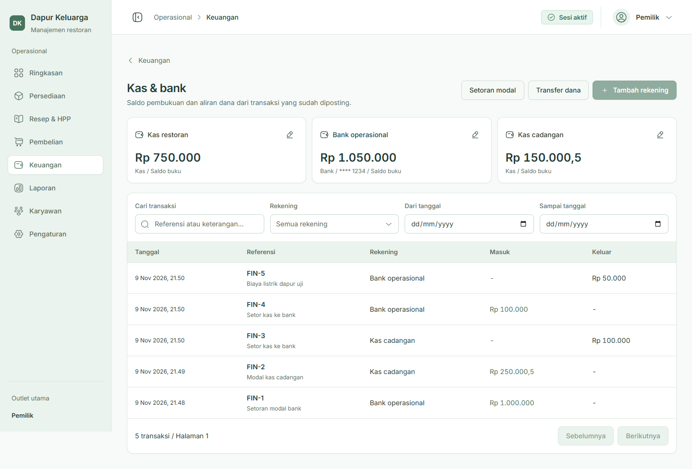
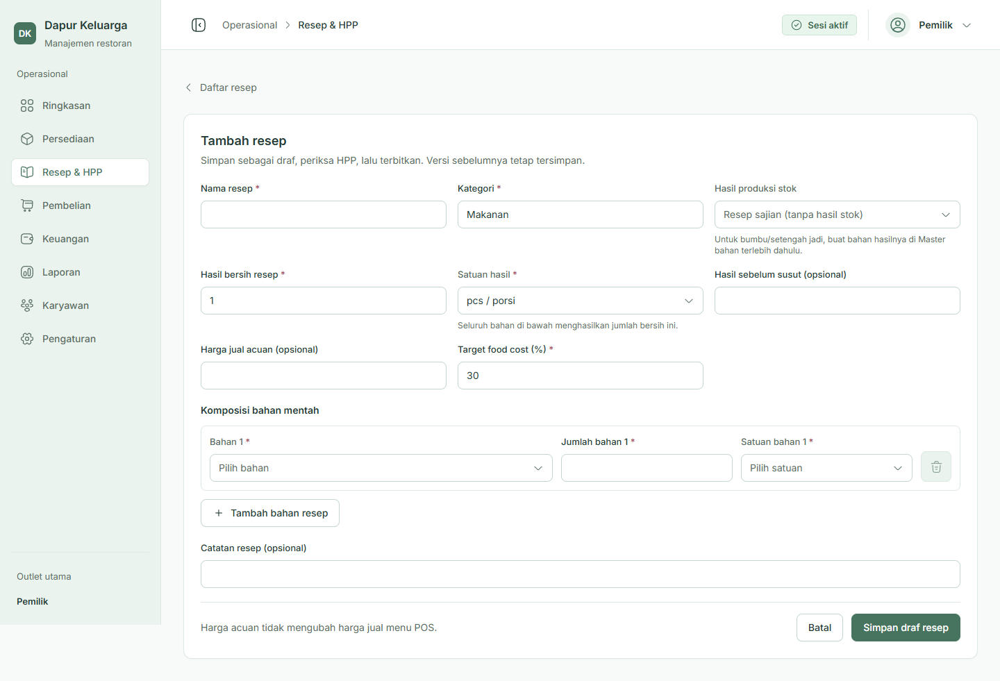
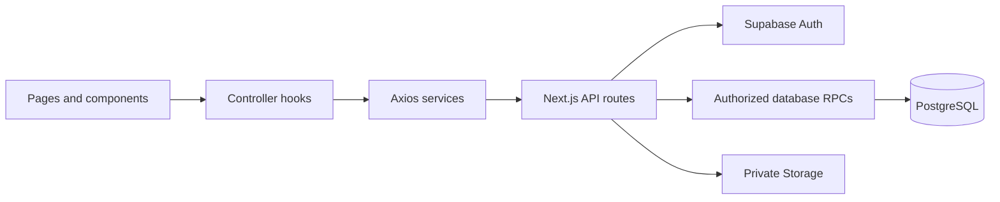

<div align="center">

# Family Restaurant ERP

### Ingredients, recipes, and finance in one back office.

A restaurant management application for **Dapur Keluarga**, connecting purchasing, inventory, recipe costing, kitchen preparation, and financial records.

[](package.json)
[](package.json)
[](tsconfig.json)
[](src/styles/globals.css)
[](src/lib/supabase/config.ts)

[Features](#features) · [Technology](#technology) · [Architecture](#architecture) · [Getting started](#getting-started)



*Application preview using local demo data. The interface is in Indonesian.*

</div>

## About the project

Family Restaurant ERP is the web back office of a small family restaurant system. It helps owners and managers follow ingredients from supplier invoices to stock, recipes, prepared ingredients, and operating costs.

The application uses **Next.js Pages Router** with **Supabase** as its primary backend. PostgreSQL RPCs handle atomic business operations, while Supabase Auth and private Storage handle identities and transaction evidence. The tablet POS is a separate application.

## Explore the application

| Module | What you can do | Route |
| --- | --- | --- |
| Overview | Review sales indicators, low stock, and operational activity | `/` |
| Employees | Manage employee profiles, roles, status, and cashier PINs | `/karyawan` |
| Purchasing | Manage suppliers, record received ingredients, attach invoices, and track payment | `/pembelian` |
| Inventory | Manage materials and units, inspect balances, count physical stock, and review adjustments | `/persediaan` |
| Recipes & costing | Build recipe versions, inspect costs, save HPP snapshots, and record ingredient production | `/resep` |
| Finance | Manage cash/bank accounts, expenses, supplier payments, journals, and bank reconciliation | `/keuangan` |

Business screens require sign-in and the appropriate permissions. Employee creation stores a profile; linking a Supabase Auth login is a separate step.

## Features

- **Received purchases → stock** — record an invoice once and increase ingredient quantities and inventory value together. Purchases can be paid or unpaid; later settlement does not add stock again.
- **Inventory control** — material masters, unit conversions, minimum stock levels, movement history, physical counts, waste, and reviewed stock corrections.
- **Recipe costing** — ingredient composition, net yield, versioned recipes, weighted-average ingredient costs, reference selling prices, and saved historical HPP snapshots.
- **Ingredient production** — record actual consumption and output for prepared ingredients, then post stock movements and balanced journal entries together.
- **Financial records** — cash/bank balances, owner capital, internal transfers, operating expenses, supplier settlement, and journal details.
- **Bank reconciliation** — import a standard CSV, skip duplicate transaction IDs, and match full or partial allocations between bank and book records.
- **Role-based access** — ERP sign-in is restricted to owners and managers. Module permissions and outlet scope are checked again on the server and in database operations.
- **Private evidence** — invoices and expense receipts use private Storage with short-lived download URLs. PDF, JPG, and PNG uploads are limited to 8 MB.
- **Readable workflows** — long forms have dedicated pages; short forms use accessible dialogs. Shared layouts, custom dropdowns, and reusable components keep navigation consistent.

<details>
<summary><strong>Preview: recipe editor</strong></summary>

<br />



*A dedicated form page keeps recipe composition separate from the list view.*

</details>

### Implementation status

Employee, purchasing, inventory, recipe/production, and finance workflows are implemented. The application remains under active development.

**Settings** now includes restaurant/charge policies, menu categories and price history, payment/receipt preferences, and protected role management. The `settings_workflows` migration was deployed on 10 November 2026 after schema/history inspection; RPC permissions and existing data counts were verified. Browser mutation tests used local fixtures. The **Reports** menu currently contains navigation/design placeholders. POS ordering, payment-provider integration, and consumption of recipe ingredients during POS sales belong to separate implementation work. Current HPP estimates describe recipe costs; they are not a completed actual-sales profitability report.

## Technology

| Area | Implementation |
| --- | --- |
| Framework | Next.js 16, Pages Router, Turbopack |
| Interface | React 19, TypeScript, Tailwind CSS 4, Inter |
| Backend | Next.js API routes and Supabase PostgreSQL RPCs |
| Authentication & files | Supabase Auth, cookie-based sessions, private Storage |
| Server state | TanStack React Query |
| UI state | TanStack React Store |
| Forms | React Hook Form |
| HTTP client | Axios |
| Animation & icons | Motion and Iconsax |
| Validation | Node.js API tests, isolated PostgreSQL checks, Playwright browser reviews |

Exact versions are recorded in [package.json](package.json) and [package-lock.json](package-lock.json).

## Architecture



- **Pages and components** render the interface; UI/form behavior lives in feature hooks.
- **Controllers** manage React Query requests, mutations, cache invalidation, and response mapping.
- **Services** call application APIs through the shared Axios client.
- **API routes** validate requests, verify sessions and permissions, and access Supabase with the user's session.
- **Database RPCs** validate business references and post related stock, money, journal, and audit records atomically.

See [AGENTS.md](AGENTS.md) for implementation conventions and [the development guide](docs/DEVELOPMENT.md) for backend prerequisites and verification details.

### Project structure

```text
.
|-- docs/                     # Development guide and demo screenshots
|-- public/                   # Public application assets
|-- src/
|   |-- components/
|   |   |-- custom/           # Employee, purchasing, inventory, recipe, finance UI
|   |   `-- shared/           # Reusable fields, dropdowns, dialogs, tables
|   |-- controller/           # React Query hooks and response mapping
|   |-- hooks/                # Form logic and local interactions
|   |-- interfaces/           # DTOs, form values, and component props
|   |-- lib/                  # Access checks, validation, server helpers
|   |-- pages/
|   |   |-- api/              # Auth and business API handlers
|   |   |-- karyawan/
|   |   |-- pembelian/
|   |   |-- persediaan/
|   |   |-- resep/
|   |   `-- keuangan/
|   |-- providers/            # Query, store, and motion providers
|   |-- services/             # Axios API functions
|   |-- stores/               # TanStack Store UI state
|   `-- styles/               # Global tokens and Tailwind recipes
|-- tests/                    # API tests and local browser fixtures
`-- .env.example              # Empty environment template
```

## Getting started

### Requirements

- Node.js **20.9 or later**, using a supported LTS release.
- npm and Git.
- A configured Supabase backend and an authorized ERP account.

### 1. Install

```bash
git clone https://github.com/TioNovriadiPutra/family-restaurant-erp.git
cd family-restaurant-erp
npm ci
```

### 2. Configure the environment

Copy [.env.example](.env.example) to `.env.local`, then fill in the project URL and publishable key for your authorized development backend:

```dotenv
NEXT_PUBLIC_SUPABASE_URL=https://YOUR_PROJECT_REF.supabase.co
NEXT_PUBLIC_SUPABASE_PUBLISHABLE_KEY=YOUR_PUBLISHABLE_KEY
```

The current business flows use the authenticated user's session. `SUPABASE_SECRET_KEY` in the template is reserved for future server-side Auth administration and can remain empty.

Backend schema, RPC migrations, and owner bootstrap are maintained in the parent restaurant-system workspace and are **not included in this standalone ERP repository**. Coordinate backend setup with the maintainer; connecting to an empty Supabase project alone will not create the required tables or permissions.

### 3. Start development

```bash
npm run dev
```

Open **http://localhost:3000** and sign in through `/login`. Your Auth account must be linked to an active employee profile with an authorized owner/manager role.

### Available commands

| Command | Purpose |
| --- | --- |
| `npm run dev` | Start the development server |
| `npm run build` | Validate TypeScript and create a production build |
| `npm start` | Serve the production build |
| `npm run lint` | Run ESLint |
| `npx tsc --noEmit` | Check TypeScript without generating files |

API tests and fixture browser reviews are documented in [Development & verification](docs/DEVELOPMENT.md#verification).

## Design system

The interface uses a sage-green palette, neutral surfaces, Inter typography, and shared form/table styles. Tokens and Tailwind component recipes live in [globals.css](src/styles/globals.css), with examples in [the style guide](src/styles/README.md).

The header and sidebar share a persistent ERP layout across page transitions. Common controls live in `components/shared`; feature-specific sections live in `components/custom`. Form interactions, interfaces, and UI stores each have their own folders.

## Deployment

Deploy using a **Next.js server runtime**, such as Vercel or a Node.js host:

1. Install dependencies using the committed npm lockfile.
2. Configure the authorized Supabase environment variables before building.
3. Run `npm run build` and use the platform's Next.js runtime, or `npm start` on a Node.js host.
4. Verify login, route permissions, API requests, and private file downloads against the configured backend.

The application uses API routes and server-side session checks; static export is not supported by these workflows. Changes to `NEXT_PUBLIC_*` values require a rebuild.

## Security & repository scope

- Commit the empty `.env.example`; keep local environment values, secret keys, tokens, and authenticated browser sessions private.
- The public repository contains application source and reviewed demo screenshots. Local review artifacts, backups, and tool configuration are excluded by `.gitignore`.
- ERP access uses Supabase Auth, scoped permissions, RLS, and guarded business RPCs. The current business APIs do not use a service-role key to bypass user authorization.
- Employee profiles and cashier PIN administration are separate from provisioning a new Supabase Auth login.

## Maintainer

Developed by [Tio Novriadi Putra](https://github.com/TioNovriadiPutra).

No open-source license has been declared in this repository.

<div align="center">

[Getting started](#getting-started) · [Development guide](docs/DEVELOPMENT.md) · [Back to top](#family-restaurant-erp)

</div>


### Pengaturan meja

Buka **Pengaturan > Meja** untuk menambah/edit kode, kapasitas dan status aktif meja POS melalui modal singkat. Status terisi/tagihan mengikuti transaksi secara otomatis. Meja dengan pesanan berjalan tidak dapat diubah; nonaktifkan meja yang tidak digunakan untuk menjaga riwayat. Implementasi mengikuti API > services > controller > hooks/components dan Supabase RPC/RLS. Migration `20261110115156_dining_table_settings.sql` sudah diterapkan. Sepuluh meja awal M01-M10 dibuat melalui form dan diverifikasi pada POS.


### Modern Hospitality UI

Refresh pertama ERP mencakup token warna semantik, sidebar, header, ringkasan harian, grafik penjualan, tindak lanjut dan aktivitas. Tampilan memakai Inter, latar stone, surface putih, dan aksen hijau; CSS bersama memperbarui fondasi formulir/tabel di modul lain. Komposisi detail setiap modul tetap menggunakan workflow yang sudah ada. Layar menengah memakai dua kolom metrik; ponsel satu kolom dengan navigasi dialog.

Pedoman frontend: gunakan Taste sesuai `AGENTS.md`. Referensi lintas aplikasi: `../family-restaurant-shared/design/HOSPITALITY-REFRESH.md`; perubahan palet POS masih tahap berikutnya. Pemeriksaan browser memakai aplikasi Next.js dengan backend fixture terisolasi di loopback, bukan data/otorisasi Supabase hosted.

Validasi refresh: lint, typecheck, 12 tests, build produksi dan interaksi browser pada data fixture lolos. Audit performa produksi mencatat 0 FAIL dan 2 WARN ukuran JavaScript. Batasan gate visual Taste dan cakupan pemeriksaan: [catatan review UI](docs/ui-refresh.md).


### Revisi UI berdasarkan referensi pengguna (ERP saja)

Arah visual terbaru memakai putih, teal dan oranye: kartu ringkasan terpisah, grafik tujuh hari berdampingan dengan performa menu, serta estimasi laba/tindak lanjut/aktivitas di bagian bawah. Header memiliki pencarian navigasi sesuai izin akun. Ini menggantikan arah stone sebelumnya; data dashboard, API, Auth/RBAC dan flow bisnis tetap dipertahankan. POS tidak diubah.

Catatan revisi referensi dan validasi terbaru: [ERP reference redesign](docs/ui-reference-refresh.md).

Penerapan desain kini mencakup halaman seluruh modul, formulir, detail, dialog dan Login: [cakupan UI ERP](docs/ui-all-pages.md).
